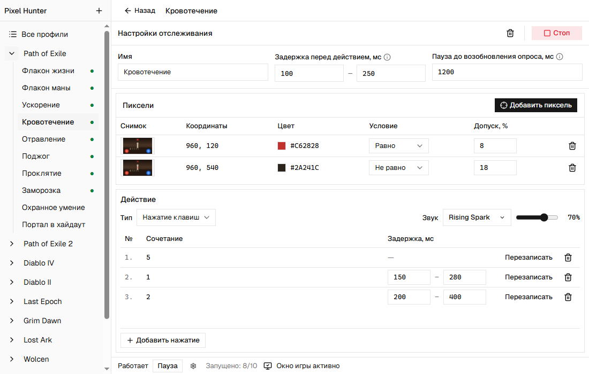

# Pixel Hunter

Pixel Hunter отслеживает изменения на экране игры и автоматически нажимает нужные клавиши.

Когда бой требует внимания, легко пропустить момент для лечения или восстановления маны. Pixel Hunter помогает автоматизировать такие действия: вы выбираете точки на экране, задаёте условия проверки цвета и указываете, какие клавиши нужно нажать при их выполнении. Например, программа может использовать флакон, когда запас здоровья опустится ниже выбранного уровня, или снять кровотечение при появлении его значка.

Программу можно настроить для Path of Exile, Diablo, Last Epoch, Grim Dawn, Terraria и других игр, в которых состояние персонажа или доступность действия можно определить по интерфейсу.

## Как это устроено

1. **Создайте профиль для игры.** Профиль привязывается к её процессу. Программа нажимает клавиши только тогда, когда окно этой игры находится на переднем плане.
2. **Добавьте отслеживания.** Каждое отслеживание отвечает за отдельное действие: использование флакона жизни или маны, снятие кровотечения, активацию защитного умения. Их можно запускать и останавливать независимо друг от друга.
3. **Выберите точки на снимке окна игры.** Для каждой точки задайте цвет, условие «равно» или «не равно» и допустимое отклонение в процентах. Допуск позволяет учитывать небольшие изменения оттенка.
4. **Настройте условия срабатывания.** Если выбрано несколько точек, должны выполняться условия для каждой из них. Например, можно проверять одновременно уровень здоровья и наличие заряда во флаконе.
5. **Укажите клавиши и задержки.** Программа может нажать одну клавишу или выполнить последовательность нажатий с паузами между шагами. Перед действием используется случайная задержка из заданного диапазона, а после него — пауза до следующей проверки. При желании срабатывание можно сопровождать звуком.
6. **Задайте сочетание клавиш для общей паузы.** Приостановить работу всех отслеживаний можно кнопкой в приложении или выбранным сочетанием клавиш. После снятия паузы запущенные отслеживания продолжат работу.

## Скриншоты

### Отдельный профиль для каждой игры

В профиле сохраняются выбранный процесс игры и все настроенные для неё отслеживания. Можно создать несколько профилей и переключаться между ними, не настраивая программу заново.

### Управление отслеживаниями

Для каждого действия можно задать собственные задержки. Запущенные отслеживания отмечены зелёной точкой; рядом с ними отображается кнопка «Стоп». Остановленные можно включить кнопкой «Старт». В нижней части окна показаны состояние окна игры и количество запущенных отслеживаний — в этом примере 8 из 10.

### Проверка цвета и нажатие клавиши

В этом примере отслеживание «Флакон жизни» нажимает клавишу `1`, когда выполняются все три условия:

- цвет точки в центре сферы здоровья отличается от `#E44532`, что указывает на снижение здоровья;
- цвет точки на краю сферы остаётся `#4A1410`, подтверждая, что нужный элемент интерфейса находится на экране;
- цвет точки в слоте флакона совпадает с `#C4A15A`, что указывает на наличие заряда.

Перед нажатием программа выдерживает случайную задержку от 40 до 120 мс. После нажатия проверка приостанавливается на 800 мс. Звуковой сигнал сообщает о срабатывании отслеживания.

### Последовательность нажатий

Отслеживание «Кровотечение» проверяет значок эффекта и точку в центре экрана. Когда оба условия выполняются, программа последовательно нажимает `5`, `1` и `2`, выдерживая заданные паузы между шагами. В этом примере первое нажатие снимает кровотечение, а следующие используют флаконы жизни и маны.

## Возможности

- Отдельные профили для разных игр, привязанные к их процессам.
- Независимый запуск и остановка отслеживаний внутри профиля.
- Выбор точек на снимке окна игры.
- Проверка совпадения или отличия цвета с настраиваемым допуском.
- Проверка нескольких точек перед выполнением действия.
- Нажатие клавиш и сочетаний, в том числе в заданной последовательности.
- Настраиваемые задержки перед действием, между шагами и до следующей проверки.
- Звуковое оповещение о срабатывании.
- Общая пауза с управлением из приложения или сочетанием клавиш.
- Автоматические нажатия только при активном окне выбранной игры.
