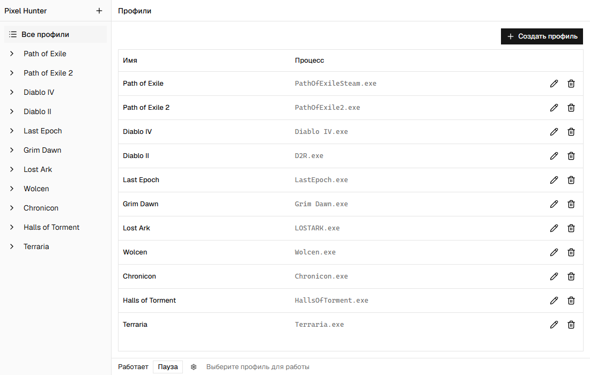
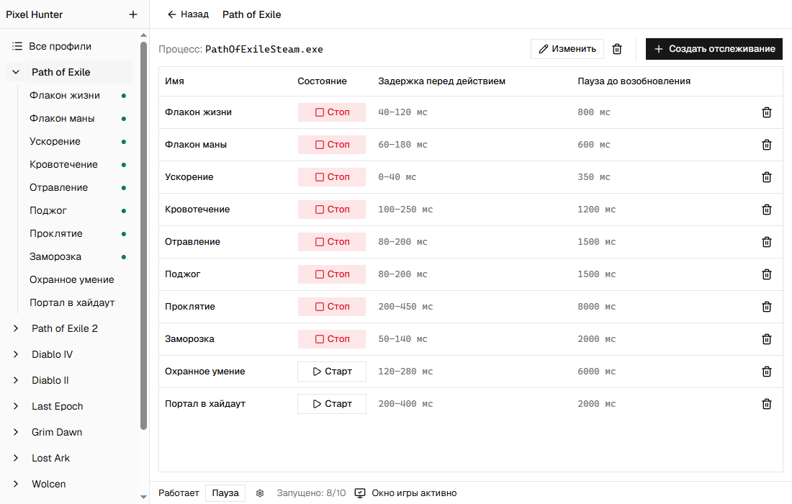
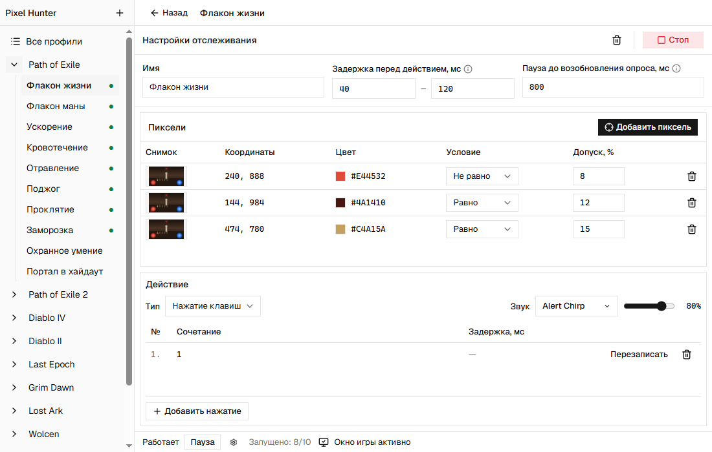
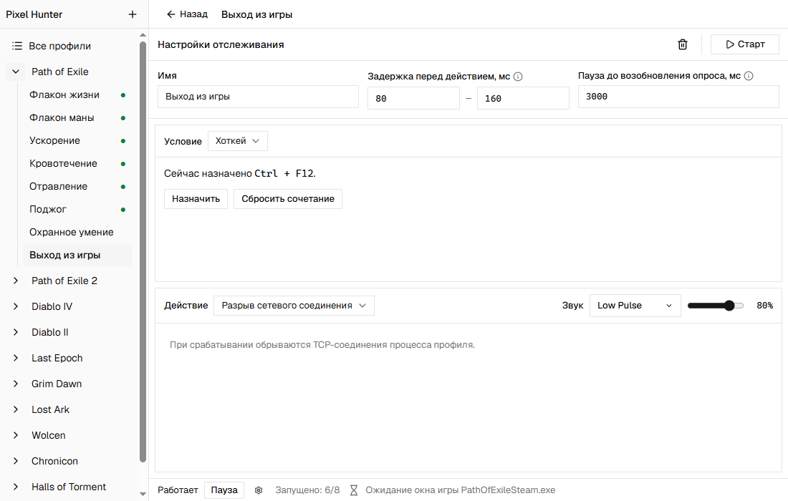

# Pixel Hunter

Pixel Hunter — приложение для Windows, которое выполняет действия в игре по цвету пикселей, появлению иконки или нажатию хоткея. Оно нажимает клавиши и сочетания, запускает последовательности нажатий или разрывает TCP-соединения игры.

Например, можно настроить использование флакона при снижении здоровья, снятие кровотечения при появлении его значка или отключение от сервера по `Ctrl + F12`.

Для каждой игры создаётся профиль с выбранным процессом и отслеживаниями. Отслеживание связывает условие запуска с действием: что проверить и что сделать при срабатывании. Каждое отслеживание запускается и останавливается отдельно.

## Быстрый старт

1. Создайте профиль и выберите процесс игры.
2. Добавьте отслеживание и назовите его по задаче, например «Лечение».
3. Выберите условие: «Визуальное» для проверки пикселей и иконок или «Хоткей» для запуска с клавиатуры. Настройка каждого варианта описана ниже.
4. Выберите действие: «Нажатие клавиш» или «Разрыв сетевого соединения».
5. Настройте задержки и, если нужен, звуковой сигнал.
6. Нажмите «Старт» у отслеживания и переключитесь в игру.

Действия выполняются только при активном окне выбранной игры. Чтобы приостановить все отслеживания, нажмите «Пауза» в приложении или назначьте для общей паузы отдельное сочетание клавиш.

## Условия запуска

### Цвет пикселей

Проверка пикселей подходит для элементов, которые остаются на одном месте: полосы здоровья, запаса маны или индикатора готовности умения.

1. Выберите условие «Визуальное» и нажмите «Добавить пиксель».
2. Переключитесь в игру и нажмите `PrintScreen`.
3. Выберите точку на снимке.
4. Задайте цвет, условие «равно» или «не равно» и допустимое отклонение.

Если добавлено несколько точек, действие запускается, когда выполняются условия для каждой из них. Снимок делается с основного монитора, поэтому разместите игру на нём.

### Поиск иконок

Поиск иконок подходит для значков эффектов, которые могут перемещаться внутри панели.

1. Выберите условие «Визуальное» и нажмите «Добавить иконку».
2. Переключитесь в игру и нажмите `PrintScreen`.
3. На снимке выделите область поиска, затем образец иконки внутри неё.
4. Выберите «Иконка должна быть» или «Иконки не должно быть» и задайте порог сходства от 1 до 100%.

Пиксели и иконки можно объединять в одном отслеживании или использовать по отдельности. Все добавленные условия должны выполняться одновременно.

Программа ищет образец в исходном размере, без поворота и масштабирования. После изменения масштаба интерфейса игры добавьте образец заново. Порог задаёт требуемое сходство с образцом; это не вероятность правильного распознавания.

### Хоткей

Выберите условие «Хоткей», нажмите «Назначить» и запишите клавишу или сочетание, например `Ctrl + 1`. Нажатие запускает действие без проверки пикселей и иконок.

## Действия

| Действие | Настройка |
| --- | --- |
| Нажатие клавиш | Добавьте клавишу, сочетание или последовательность нажатий с паузами между шагами. |
| Разрыв сетевого соединения | Выберите тип действия. Дополнительных настроек нет: при срабатывании программа обрывает TCP-соединения процесса, выбранного в профиле. |

Для каждого отслеживания можно задать случайную задержку перед действием в выбранном диапазоне и паузу до следующей проверки. Звуковой сигнал помогает услышать срабатывание; его громкость настраивается отдельно.

## Примеры настройки

### Профили игр

Профиль хранит процесс игры и её отслеживания. При переключении между играми настройки сохраняются.

### Запуск и остановка отслеживаний

Зелёная точка отмечает запущенное отслеживание. Кнопки «Старт» и «Стоп» управляют им независимо от остальных. Внизу окна видны число запущенных отслеживаний и состояние окна игры.

### Снятие кровотечения

В этом примере отслеживание проверяет две точки: цвет первой должен совпасть с `#C62828`, а второй — отличаться от `#2A241C`. Когда оба условия выполнены, программа ждёт от 100 до 250 мс и по очереди нажимает `5`, `1` и `2` с паузами между шагами. После последовательности проверка приостанавливается на 1 200 мс. О срабатывании сообщает звук Rising Spark.

### Отключение от сервера

В этом примере `Ctrl + F12` обрывает TCP-соединения процесса игры. О срабатывании сообщает звук Low Pulse.
